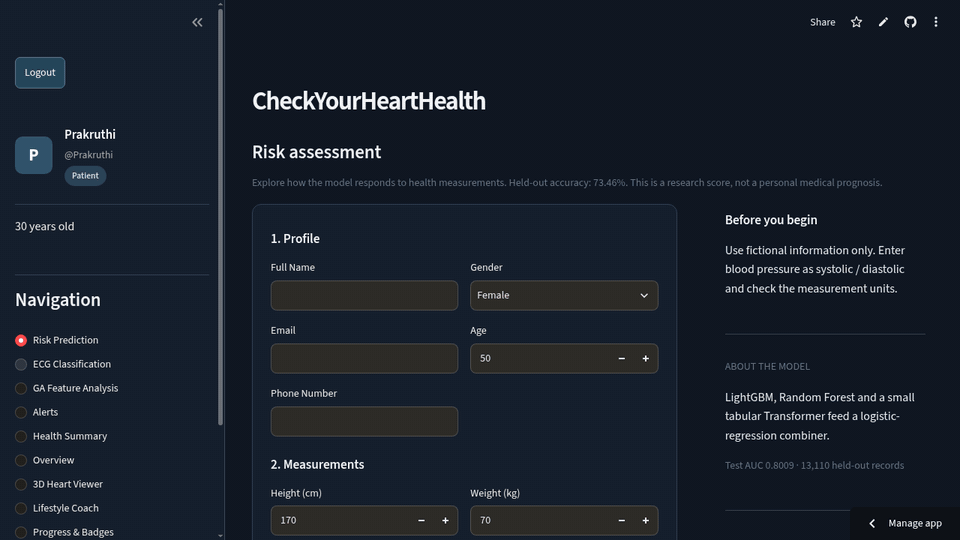

# CheckYourHeartHealth

A Streamlit app that estimates heart disease risk from basic health data. I built it as a student project, in a rush, and the first version made some things look like they worked when they didn't. This README is the honest version after going back through the code.

It is a learning project. Don't use it to make real health decisions.



## What actually works

- **Risk prediction.** You enter age, height, weight, blood pressure, cholesterol, glucose, smoking, alcohol and activity. The stacking ensemble trained on the Kaggle cardiovascular disease dataset (about 65,500 rows after cleaning) gives a risk percentage.
- **Accounts and roles.** Patient, doctor and admin logins, backed by SQLite. Doctors can see linked patients, leave notes and get alerts.
- **History and what-if.** Repeat risk scores are saved per patient. What-if scenarios run through the risk model. The health-context notes use hand-written rules, not SHAP or LIME. They are not measured per-factor effects.
- **3D heart viewer.** The existing external/open-heart OBJ geometry rendered with Plotly, with rotation and zoom. This works without a localhost server. It is an anatomy illustration, not a validated blood-flow or disease-progression simulation.

## Real numbers

Measured on a held-out 20% test split (13,110 rows the model never saw during training). `train_model.py` and `train_ensemble.py` in `src/risk_prediction/` reproduce them.

| Model | Accuracy | AUC |
|---|---|---|
| Logistic regression (baseline) | 72.3% | 0.789 |
| Random forest | 73.1% | 0.800 |
| Transformer (small, tabular) | 73.4% | 0.799 |
| LightGBM | 73.4% | 0.801 |
| Stacked ensemble (app default: LightGBM + RF + Transformer, logistic-regression combiner) | 73.46% | 0.8009 |

The ensemble is within noise of LightGBM. The measured gap is just 0.07 percentage points of accuracy. I have not measured confidence intervals or repeated-seed variation, so I cannot call that a meaningful improvement. These runs do not prove a hard limit on the dataset. I built the ensemble to learn stacking.

5-fold cross-validation on the training part gave 73.1% accuracy and 0.799 AUC for LightGBM.

The app loads the trained ensemble by default. Its artifact is stored as base64 chunks with a checksum because direct binary upload failed. No training is needed to use it. If those files cannot load, the app tries LightGBM and reports the model used. If neither loads, no score is produced. To retrain the ensemble, run `python src/risk_prediction/train_ensemble.py`.

One caveat: the repo only has a standardized copy of the dataset, so I recovered the original units (years, cm, kg, mmHg) from it. They are close, not guaranteed identical to the original file.

## What does not work (yet)

- **ECG photos.** Not supported. The old hardcoded "Normal Beat, 95%" result is gone. The new classifier accepts signals only, as described below.
- **The old stacking ensemble (Transformer + LightGBM + Random Forest + MLP).** The app never used it, and it was trained on standardized data while the app sent raw values. The old "~70% accuracy, 0.79 AUC" came from a 2,622-row test set. I replaced it with the retrained ensemble in the table above.
- **Genetic algorithm / PSO feature selection.** Experiments only. The PSO run in `logs/` failed. The app doesn't use either.
- **SHAP and LIME.** Not wired to the real model. The health-context notes are rule-based. Unsupported per-factor percentage charts have been removed from the app and its report.

## ECG signals

I trained a small residual 1D-CNN on raw [PTB-XL 1.0.3](https://physionet.org/content/ptb-xl/1.0.3/) signals, not images. It predicts five overlapping diagnostic superclasses: NORM, MI, STTC, CD and HYP. This is separate from the tabular risk model.

| ECG model | Held-out macro AUC |
|---|---|
| LightGBM on hand-made signal features | 0.8764 |
| 1D-CNN (the ECG app model) | 0.9303 |

CNN per-class AUC: NORM 0.9509, MI 0.9295, STTC 0.9386, CD 0.9236, HYP 0.9089. These are single-run results, not accuracy. No confidence intervals or clinical calibration checks yet.

The official patient-wise folds are 1-8 for training (17,084 records), 9 for validation and best-epoch selection (2,146), 10 for test (2,158). No patient appears in more than one split. I excluded records without a diagnostic superclass. The CNN trained for 12 epochs on CPU. LightGBM was a fixed feature baseline, not an exhaustive search.

Upload a CSV with 1000 rows (10 seconds at 100 Hz), millivolt values, and columns `I,II,III,AVR,AVL,AVF,V1,V2,V3,V4,V5,V6`. No timestamp/index column. Scores can overlap and do not add to 100%. They are not a diagnosis or a safe way to rule out disease. Do not upload real patient data to a public demo. Training scripts and data setup are in `CheckYourHeartHealth/backend/ecg_training/`.

Data credit: Wagner et al., PTB-XL 1.0.3, PhysioNet, DOI 10.13026/kfzx-aw45. Follow the dataset's license. The repo bundles trained weights, not the dataset.

## How to run it

```bash
cd CheckYourHeartHealth/backend
pip install -r requirements.txt
streamlit run app.py
```

The shipped ensemble loads without training. Only if the ensemble cannot load and the fallback artifact is missing does the app train LightGBM and save `src/risk_prediction/heart_risk_model.joblib`. To retrain and re-measure that fallback by hand:

```bash
python src/risk_prediction/train_model.py
```

That writes the model file and `src/risk_prediction/metrics.json`.

Secrets go in your own `.env` file (not committed). The app reads them with python-dotenv.

## Accounts and demo limits

Public signup creates a patient account only. Passwords need at least 12 characters and use salted PBKDF2-SHA256. Existing SHA256 passwords upgrade after a successful login. Inactive users cannot sign in. A local operator can provision the first administrator with `python provision_user.py USERNAME --role admin --name "Name"`; passwords are entered through a hidden prompt. Administrators can provision doctor accounts. There are no committed demo credentials.

Doctors can assess only linked patients, and the result is saved to that patient's ID. Patient self-linking and administrator-managed links are available. ECG model scores are kept separate from tabular risk trends and do not trigger critical-finding alerts. The application's other score alerts are demo rules, not medical warnings.

Use fictional information only. This is not a production clinical system: it lacks independently reviewed security, persistent hosted storage, verified clinician identities, and clinical validation. The login throttle is session-local, not a distributed defense. SQLite history survives local restarts, but Streamlit Community Cloud disk is not durable and can reset on redeploy/reboot. Real patient history requires an external database and a separate privacy/security design.
